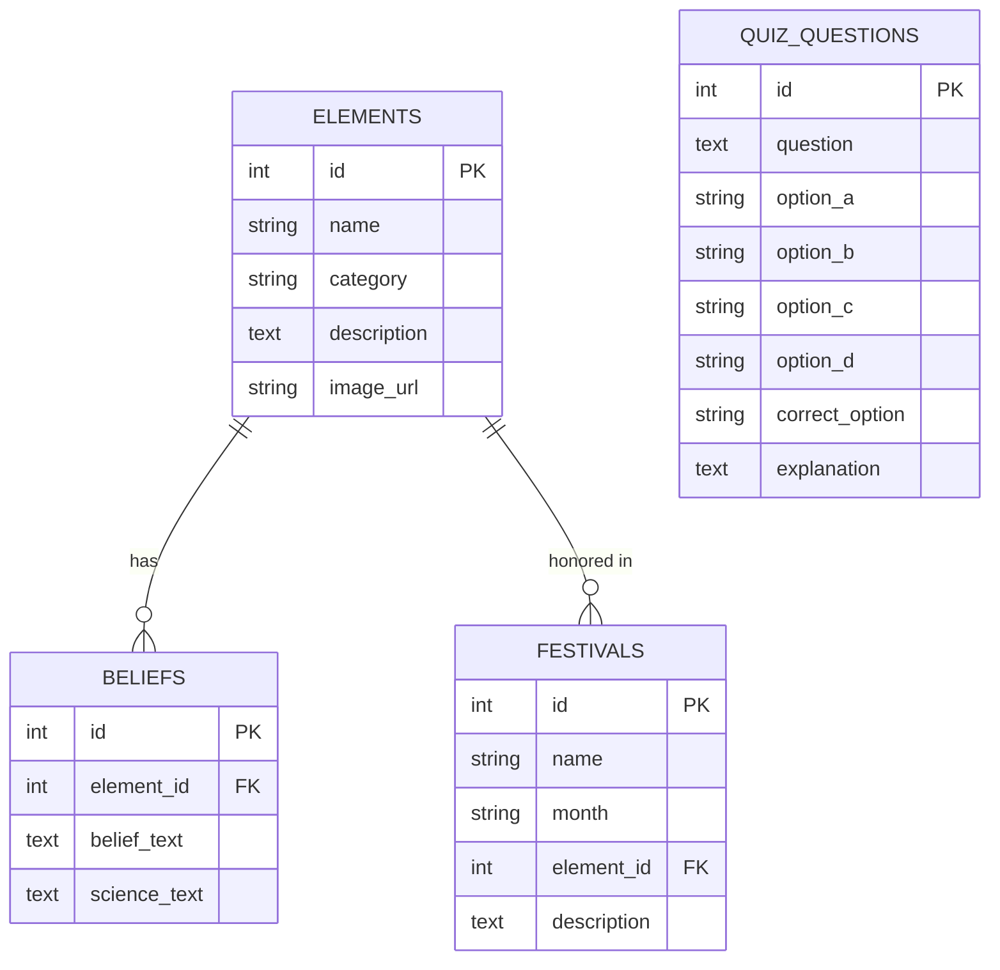

# 🌿 Prakriti: Nature & Belief Explorer

> **Where Sacred Indian Tradition Meets Ecological Wisdom**  
> A web platform documenting elements of nature worshiped across India, illuminating the cultural reverence, linked festivals, and the profound scientific and ecological foresight behind each tradition.

---

## 📖 Table of Contents
1. [Overview & Philosophy](#-overview--philosophy)
2. [Key Features](#-key-features)
3. [Tech Stack](#-tech-stack)
4. [Project Structure](#-project-structure)
5. [Quickstart & Installation](#-quickstart--installation)
6. [Database Schema](#-database-schema)
7. [The 12 Sacred Nature Elements](#-the-12-sacred-nature-elements)
8. [Festivals Calendar](#-festivals-calendar)
9. [Interactive Quiz](#-interactive-quiz)
10. [Admin Portal](#-admin-portal)
11. [Visual Walkthrough & Screenshots](#-visual-walkthrough--screenshots)

---

## 🌍 Overview & Philosophy

For millennia, communities across India have revered the Sun, sacred rivers, holy trees, snakes, mountains, fire, and Mother Earth. Modern observers sometimes mislabel these rituals as mere superstition. **Prakriti** bridges this divide by presenting:

1. **Reverence as Sacred Duty (*Dharma*)**: Rather than viewing nature as a commodity to exploit, tradition elevates vital natural phenomena into living divinities, guaranteeing intergenerational conservation.
2. **Empirical Ecological Foresight**: Shows how tabooing tree-cutting (*Peepal*, *Banyan*), protecting rodent-controlling serpents (*Nag Panchami*), and timing water offerings with solar angles (*Chhath Puja*) aligned with seasonal microbiology, public health, and biodiversity preservation.

---

## ✨ Key Features

1. **Home Page (`/`)**:
   - Atmospheric hero section featuring the sacred Vedic *Shanti Mantra*.
   - Live statistics ribbon (Elements, Beliefs, Festivals, Quiz questions).
   - Responsive card grid displaying all 12 nature elements.
   - The Three Pillars of Nature Worship (Sacred Duty, Agrarian Timing, Microbiome & Health).

2. **Browse & Live Filter Page (`/browse`)**:
   - Instant client-side search box filtering by name, keywords, and significance.
   - Category pill filters (*Celestial Bodies*, *Flora & Sacred Plants*, *Fauna & Sacred Animals*, *Water Bodies*, *Earth & Landforms*, *Elemental Forces*).
   - Festival dropdown filter.
   - Dynamic counter and no-results fallback.

3. **"Belief vs Science" Element Detail Page (`/element/<id>`)**:
   - Custom SVG vector illustration of the element.
   - **Belief vs Science Side-by-Side Card**:
     - *Tradition Side (Saffron theme)*: Cultural myths, spiritual reverence, rituals.
     - *Science Side (Forest green theme)*: Botanical, microbiological, and ecological rationale.
   - *Ancient Ecological Foresight* synthesis card.
   - Linked festivals showcase with celebration timing.
   - Previous / Next element navigation.

4. **Festivals Calendar Page (`/festivals`)**:
   - Chronological listing of festivals honoring natural elements.
   - Gregorian and traditional Hindu calendar months.
   - Direct link pill to the element honored by each festival.

5. **"Superstition or Science?" Interactive Quiz (`/quiz`)**:
   - 10 carefully researched, educational multiple-choice questions.
   - Live progress bar and running score counter.
   - Instant feedback on click: correct option in green, incorrect in red.
   - Detailed scientific explanation box revealed immediately after each answer.
   - Celebratory final score card with custom badges (*Prakriti Acharya*, *Eco-Guardian*, *Curious Seeker*).
   - Complete review section showing every question, user answer, and full explanation.

6. **Curator / Admin Portal (`/admin`)**:
   - Secure password-protected dashboard (`Password: prakriti2026`).
   - Full CRUD operations:
     - **Elements**: Add, Edit, and Delete nature elements.
     - **Beliefs**: Add, Edit, and Delete Tradition vs Science records.
     - **Festivals**: Add, Edit, and Delete eco-festivals.
     - **Quiz Questions**: Add, Edit, and Delete 4-option quiz questions with explanations.
   - Flash notifications and confirmation dialogs.

---

## 🛠️ Tech Stack

- **Backend**: Python 3.10+ / Flask 3.x
- **Database**: SQLite3 (zero-configuration, built-in)
- **Frontend**: Vanilla HTML5, CSS3, Modern JavaScript (ES6+) — *No heavy frontend frameworks*
- **Typography**: Google Fonts (*Cinzel* classical serif, *Plus Jakarta Sans* readable sans)
- **Color Palette**:
  - Warm Parchment / Cream: `#FAF6EF`, `#F4ECE0`
  - Earthy Forest Greens: `#1E3F1A`, `#2D5A27`, `#4A7A42`, `#EBF4E9`
  - Saffron & Terracotta: `#D95F1A`, `#E2722C`, `#A8441D`, `#FDF1E8`
  - Sacred Gold: `#C58B24`, `#FFE082`

---

## 📂 Project Structure

```
prakriti/
├── app.py                  # Main Flask application and routing logic
├── database.py             # SQLite connection, table schema, seeding, and CRUD queries
├── test_app.py             # Automated test suite verifying 100% of routes and operations
├── requirements.txt        # Python package dependencies (Flask)
├── README.md               # Documentation and setup guide
├── prakriti.db             # SQLite database file (created automatically on startup)
├── static/
│   ├── css/
│   │   └── style.css       # Master responsive stylesheet (Earthy Green & Saffron theme)
│   ├── js/
│   │   ├── main.js         # Mobile nav, live search & category filters, admin tabs
│   │   └── quiz.js         # 10-question interactive quiz engine & scoring system
│   └── images/
│       ├── logo.svg        # Auspicious Peepal leaf, Sun, and Water drop brand mark
│       ├── surya.svg       # Radiant 12 rays of the Sun & Arghya offering
│       ├── ganga.svg       # Holy river descending from snow peaks with floating diya
│       ├── tulsi.svg       # Sacred Tulsi plant in courtyard altar (Chaura) with lamp
│       ├── peepal.svg      # Sacred Fig tree with heart-shaped drip-tip leaf
│       ├── nag.svg         # Five-headed cobra (Sheshnaga) with milk offering
│       ├── cow.svg         # Indigenous Desi cow (Bos indicus) with hump and bell
│       ├── agni.svg        # Vedic Havan Kunda with dynamic sacred flames
│       ├── govardhan.svg   # Lifted mountain canopy sheltering pastures
│       ├── chandra.svg     # Full Moon of Sharad Purnima with nocturnal tides
│       ├── prithvi.svg     # Mother Earth globe supported by lotus with new sprouts
│       ├── banyan.svg      # Vast Banyan tree (Akshaya Vata) with pillar prop roots
│       └── neem.svg        # Medicinal Neem branch with blossoms and Ugadi jaggery
└── templates/
    ├── base.html           # Master layout template (navbar, alerts, footer)
    ├── index.html          # Home landing page with hero, stats, and element grid
    ├── browse.html         # Live search & category filtering catalog
    ├── detail.html         # "Belief vs Science" side-by-side card & linked festivals
    ├── festivals.html      # Festivals calendar honoring elements of nature
    ├── quiz.html           # "Superstition or Science?" interactive challenge
    ├── admin_login.html    # Password login screen for curators
    ├── admin.html          # Admin dashboard with tabs for Elements, Beliefs, Festivals, Quiz
    └── admin_edit.html     # Dedicated edit form for modifying any database entity
```

---

## 🚀 Quickstart & Installation

### Step 1: Open Terminal and Navigate to the Project
```bash
cd "C:\Users\jayac\.gemini\antigravity\scratch\prakriti"
```

### Step 2: Install Dependencies
Flask is typically pre-installed. If installing fresh:
```bash
pip install -r requirements.txt
```

### Step 3: Run the Application
```bash
python app.py
```
*(On systems where Python is in a custom path, use your Python binary, e.g., `& "C:\Users\jayac\AppData\Local\Python\pythoncore-3.14-64\python.exe" app.py`)*

### Step 4: Open in Your Browser
Visit:
```
http://127.0.0.1:5000
```

### Step 5: Run Automated Tests
```bash
python test_app.py
```
All tests should pass with `100% SUCCESS`.

---

## 🗄️ Database Schema

The database uses SQLite (`prakriti.db`) with four normalized tables:



---

## 🌿 The 12 Sacred Nature Elements

| # | Element Name | Category | Cultural Tradition | Ecological Science |
|---|--------------|----------|-------------------|-------------------|
| 1 | **Surya (The Sun)** | Celestial Bodies | Visible divinity (*Pratyaksha Devata*), soul of all beings; offered water at sunrise. | Drives photosynthesis; morning UV synthesizes Vitamin D without skin damage and resets circadian clocks. |
| 2 | **Maa Ganga & Rivers** | Water Bodies | Personified as living mother descended to purify ancestral karma. | Contains unique bacteriophages ("Ganga Factor") that neutralize harmful microbes and keep dissolved oxygen high. |
| 3 | **Tulsi (Holy Basil)** | Flora & Sacred Plants | Incarnation of Goddess Vrinda; placed at the center of courtyards (*Tulsi Chaura*). | Potent adaptogen; releases volatile eugenol and terpenes that repel mosquitoes and purify indoor air. |
| 4 | **Peepal Tree (Ashvattha)** | Flora & Sacred Plants | Abode of the Trinity (*Brahma, Vishnu, Shiva*); cutting it is strictly taboo. | Crassulacean Acid Metabolism (CAM) allows prolonged oxygen release; keystone species supporting hundreds of birds. |
| 5 | **Nag (Serpents)** | Fauna & Sacred Animals | Associated with Lord Shiva (Vasuki) and Lord Vishnu (Sheshnaga); guardians of water and fertility. | Apex rodent predator in agrarian ecosystems, preventing loss of grain silos and rodent-borne epidemics. |
| 6 | **Gomata (Desi Cow)** | Fauna & Sacred Animals | Venerated as Kamadhenu, embodying selfless motherhood and non-violence (*Ahimsa*). | Foundation of zero-budget organic farming; dung and urine (Jeevamrit) enrich soil with billions of beneficial microbes. |
| 7 | **Agni (Sacred Fire)** | Elemental Forces | Divine messenger carrying oblations to the cosmos; sacred witness to vows. | Controlled combustion of ghee, camphor, and dry woods disperses therapeutic aerosols reducing airborne bacteria. |
| 8 | **Govardhan & Mountains** | Earth & Landforms | Krishna taught communities to revere local mountains that provide water and pasture over distant rituals. | Vital watershed shields; mountain vegetation traps monsoon rains and prevents catastrophic flash flood erosion. |
| 9 | **Chandra (The Moon)** | Celestial Bodies | Lord of medicinal herbs (*Oshadhinam Adhipati*); kheer placed in full moonlight on Sharad Purnima. | Gravitational pull regulates marine tides; nocturnal dew and temperature drops facilitate nutrient settling. |
| 10 | **Prithvi (Mother Earth)** | Earth & Landforms | Revered as Bhumi Devi; morning prayer asks forgiveness for stepping on her sacred body. | Living topsoil biosphere containing mycorrhizal networks and organic carbon essential for all terrestrial food webs. |
| 11 | **Vata (Sacred Banyan)** | Flora & Sacred Plants | Akshaya Vata (the Undying Tree); honored during Vat Savitri for enduring longevity. | Vast aerial prop roots anchor hillsides against mudslides; a single mature tree forms a micro-forest sheltering 500+ species. |
| 12 | **Neem Tree (Margosa)** | Flora & Sacred Plants | Manifestation of Goddess Shitala / Mariamman protecting against pox and seasonal fevers. | Contains azadirachtin and nimbin; proven broad-spectrum antibacterial, antiviral, and natural bio-insecticide. |

---

## 🎉 Festivals Calendar

1. **Chhath Puja** (Kartika / Oct-Nov) &rarr; Honors *Surya* at riverbanks at dawn and dusk.
2. **Makar Sankranti & Pongal** (Magha / January) &rarr; Honors *Surya* & Cattle for the winter harvest.
3. **Nag Panchami** (Shravana / July-Aug) &rarr; Honors *Nag* during peak monsoon when burrows flood.
4. **Ganga Dussehra** (Jyeshtha / May-June) &rarr; Honors *Ganga* and freshwater cleanliness before monsoon.
5. **Tulsi Vivah** (Kartika / November) &rarr; Honors *Tulsi*, marking the start of winter herbal harvesting.
6. **Govardhan Puja (Annakut)** (Kartika / Oct-Nov) &rarr; Honors *Govardhan* & pasture ecosystems.
7. **Vat Purnima / Vat Savitri** (Jyeshtha / May-June) &rarr; Honors *Vata* (Banyan tree) and marital longevity.
8. **Sharad Purnima** (Ashvin / October) &rarr; Honors *Chandra* with cooling lunar kheer.
9. **Holika Dahan & Lohri** (Phalguna & Pausha / Jan & March) &rarr; Honors *Agni* for seasonal agricultural cleansing.
10. **Raja Parba** (Ashadha / June) &rarr; Honors *Prithvi* (Earth) by ceasing all tilling to let the soil rest.

---

## ❓ Interactive Quiz

The quiz challenges visitors with 10 questions testing their understanding of:
- Why Peepal cutting was prohibited
- Nag Panchami's role in rodent control
- Courtyard placement of Tulsi
- Antibacterial bacteriophages in Ganga water
- Dawn/dusk solar angles during Chhath Puja
- Soil microbiology of Desi cow dung
- Krishna's ecological lesson at Mount Govardhan
- Anthelmintic benefits of Neem and Jaggery on Ugadi
- Soil aeration during Raja Parba
- Banyan tree prop roots in flood prevention

---

## 🔐 Admin Portal

- **URL**: `http://127.0.0.1:5000/admin/login`
- **Default Password**: `prakriti2026`
- **Features**:
  - Live counts of all 4 entities.
  - Tabbed interface for smooth curation.
  - Create, Read, Update, and Delete operations with confirmation prompts and flash notices.

---

## 🎨 Visual Walkthrough & Screenshots

```
+-------------------------------------------------------------------------------+
|  🌿 PRAKRITI : Nature & Belief Explorer           [Home] [Browse] [Festivals] |
+-------------------------------------------------------------------------------+
|                                                                               |
|       ॐ द्यौः शान्तिरन्तरिक्षं शान्तिः पृथिवी शान्तिरापः शान्तिरोषधयः शान्तिः        |
|                                                                               |
|                 Where Sacred Tradition Meets Ecological Wisdom                |
|                                                                               |
|     [ 🔍 Explore Nature Elements ]             [ 🌟 Take Science Quiz ]       |
|                                                                               |
|     12 Elements   |   12 Belief Cards   |   10 Festivals   |   10 Quiz Qs     |
|                                                                               |
+-------------------------------------------------------------------------------+
|  ELEMENTS GRID                                                                |
|  +--------------------+  +--------------------+  +--------------------+       |
|  | [ Surya SVG ]      |  | [ Ganga SVG ]      |  | [ Tulsi SVG ]      |       |
|  | Surya (The Sun)    |  | Maa Ganga & Rivers |  | Tulsi (Holy Basil) |       |
|  | Celestial Bodies   |  | Water Bodies       |  | Flora & Plants     |       |
|  | View Belief vs Sci |  | View Belief vs Sci |  | View Belief vs Sci |       |
|  +--------------------+  +--------------------+  +--------------------+       |
+-------------------------------------------------------------------------------+
|  DETAIL VIEW (/element/1)                                                     |
|                                                                               |
|  +-----------------------------------+  +-----------------------------------+  |
|  | 🪔 SACRED TRADITION               |  | 🔬 ECOLOGICAL SCIENCE             |  |
|  | Visible Supreme Divinity          |  | Morning UV wavelengths synthesize |  |
|  | Water offering at sunrise (Arghya)|  | Vitamin D without skin burning    |  |
|  | sets body rhythms and health.     |  | and reset the circadian clock.    |  |
|  +-----------------------------------+  +-----------------------------------+  |
|                                                                               |
|  +-------------------------------------------------------------------------+  |
|  | 🌱 ANCIENT ECOLOGICAL FORESIGHT : Conservation encoded as Sacred Duty   |  |
|  +-------------------------------------------------------------------------+  |
+-------------------------------------------------------------------------------+
|  QUIZ ENGINE (/quiz)                                                          |
|  Progress: [=========================>              ] Question 3 of 10        |
|  "Why was Tulsi planted at the center of traditional courtyards?"             |
|                                                                               |
|  [ A ] To cast shadows during eclipses                                        |
|  [ B ] To ward off lightning strikes                                          |
|  [ C ] Emits volatile terpenes (eugenol) repelling mosquitoes  [✓ CORRECT]    |
|  [ D ] Solely as a decorative centerpiece                                     |
|                                                                               |
|  🌿 Ecological Insight: Ocimum sanctum releases volatile terpenes that act    |
|     as natural repellents and airborne antimicrobial agents.                  |
|                                                                               |
|                                                      [ Next Question → ]      |
+-------------------------------------------------------------------------------+
```

---

## 📜 License & Credits

Crafted with reverence for India's living cultural traditions and empirical ecological sciences. Open for educational, cultural, and environmental conservation initiatives.
